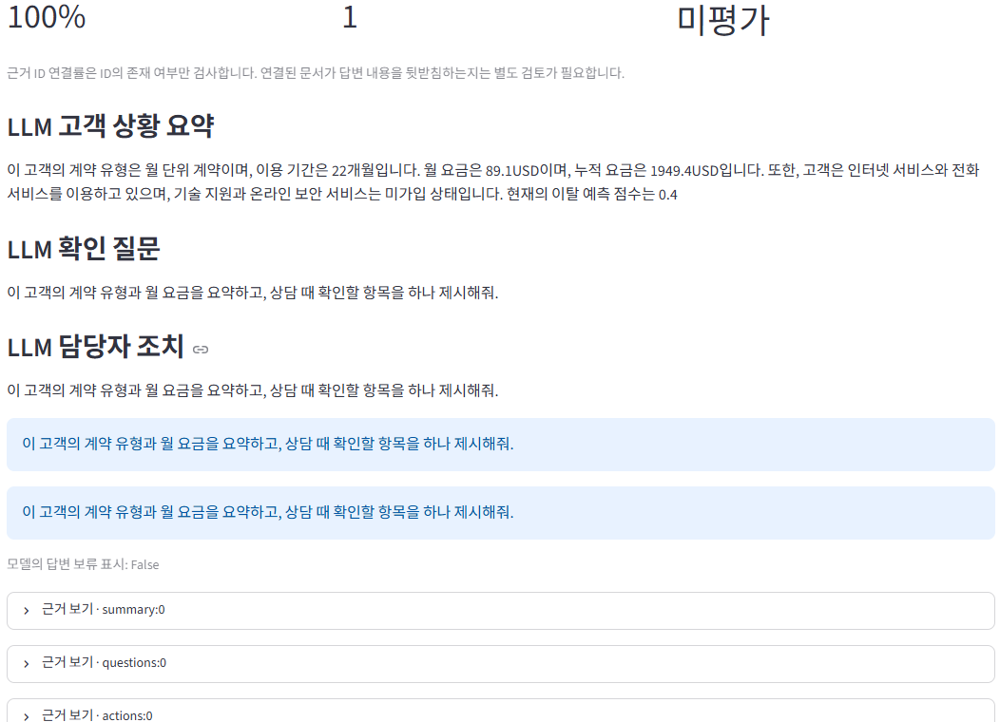

# 고객 이탈 상담 지원 LLM

상담사가 고객에게 먼저 확인할 사항을 정리할 수 있도록, 이탈 예측 정보와 상담 지침을 바탕으로 **상황 요약·확인 질문·담당자 조치·한계**를 생성하는 로컬 RAG 프로젝트입니다.

[20문항 평가 노트북](churn-llm/notebooks/churn_llm_benchmark20.ipynb) · [발표 자료 PDF](docs/presentation.pdf) · [기존 ML 프로젝트](https://github.com/Navii112/telco-churn-prediction)



## 구현

1. 기존 XGBoost 모델에서 고객의 이탈 예측 점수와 TreeSHAP 기여도를 가져옵니다.
2. 고객 정보와 질문을 바탕으로 가상 상담 지침을 검색합니다. EmbeddingGemma 검색과 TF-IDF 검색을 지원합니다.
3. Ollama에서 Qwen 2.5가 검색 근거와 함께 상담 준비 리포트를 생성합니다.
4. Python 코드가 근거 ID를 원문에 연결하고, 일부 내용 규칙을 검사합니다. 명백한 범위 밖 질문은 생성 전에 안내합니다.

## 평가

동일한 20개 질문에 두 모델과 두 구현 버전을 적용해 80회 생성을 시도했고, 79회 성공했습니다. 아래 비교에서는 두 버전 모두 RAG를 사용했습니다.

| 모델 | 생성 성공 최초 → 개선 | 필수 참조 값 표현율 | 평균 근거 ID 연결률 |
| --- | ---: | ---: | ---: |
| Qwen 2.5 1.5B | 20/20 → 19/20 | 90% → 100% | 83.25% → 95% |
| Qwen 2.5 3B | 20/20 → 20/20 | 70% → 100% | 84% → 100% |

ID 연결률은 출처를 찾을 수 있었는지를 측정합니다. 답변의 의미 정확성은 별도 사람 평가가 필요하며 이번 평가에서는 미채점입니다. 상담 지침은 시연용 가상 문서입니다.

## 실행

Python 3.12와 [Ollama](https://ollama.com/)가 필요합니다. 저장소 루트에서 PowerShell로 실행합니다.

```powershell
py -3.12 -m venv .venv
& .\.venv\Scripts\python.exe -m pip install -r requirements.txt
ollama pull qwen2.5:1.5b
ollama pull embeddinggemma
& .\.venv\Scripts\python.exe -m streamlit run .\churn-llm\app.py --server.port 8502 --server.address 127.0.0.1
```

브라우저에서 http://127.0.0.1:8502 를 열면 됩니다. 두 번째 모델을 사용하려면 `ollama pull qwen2.5:3b`를 실행하세요. 노트북의 기본 분석은 내장된 실험 기록을 읽으므로 Ollama 없이 실행할 수 있습니다. 분석 환경 의존성은 [requirements-analysis.txt](churn-llm/requirements-analysis.txt)에서 확인할 수 있습니다.

| 위치 | 내용 |
| --- | --- |
| [churn-llm/app.py](churn-llm/app.py) | Streamlit 상담 화면 |
| [churn-llm/runtime](churn-llm/runtime) | 프롬프트, 검색, 생성, 근거 검사 |
| [churn-llm/guidelines](churn-llm/guidelines) | 시연용 상담 지침 |
| [churn-llm/experiments](churn-llm/experiments) | 모델·프롬프트·RAG 비교 코드 |
| [ML](ML) | 기존 예측 모델과 상담 화면 실행에 필요한 자료 |
